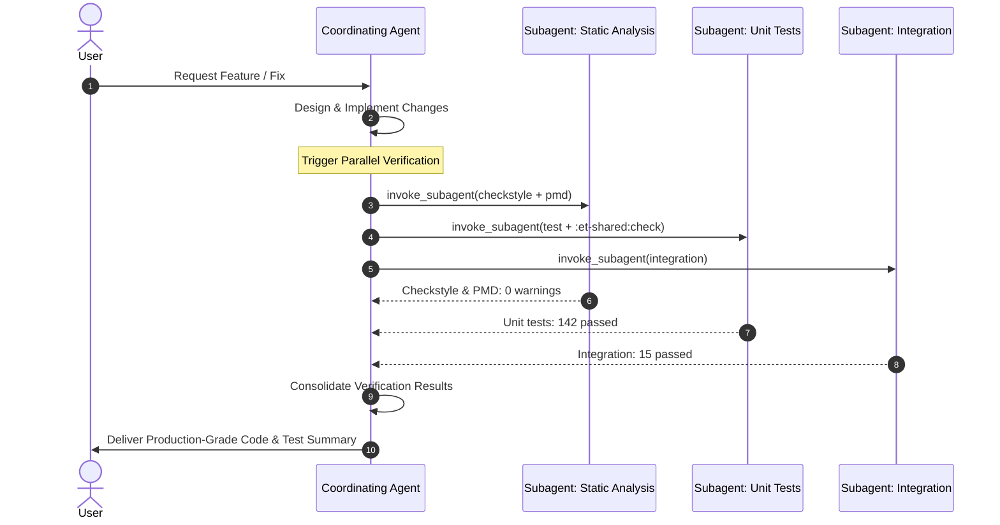

# Subagent Orchestration Guide

This document defines the roles, operational patterns, execution models, and prompt specifications for AI subagents working in the `et-ccd-callbacks` repository, as mandated by [`AGENTS.md`](../AGENTS.md#9-subagents-when-available).

---

## 1. Purpose & Core Principles

Subagents allow a primary agent to parallelize complex engineering workflows, protect context windows from large tool outputs, and enforce strict division of responsibilities across HMCTS backend and test suites.

### Core Principles
1. **Parallel Execution**: Independent tasks (such as static analysis, unit tests, and integration tests) should be delegated to subagents concurrently.
2. **Context Window Hygiene**: Heavy search outputs, deep file traversals, and lengthy build logs are isolated within subagents; only structured summaries and diffs return to the primary agent.
3. **Strict Boundary Compliance**: Subagents inherit all repository rules defined in [`AGENTS.md`](../AGENTS.md) (e.g. 0 Checkstyle warnings, 0 PMD failures, no wildcard imports, no hardcoded secrets, no `@Disabled` tests).
4. **Centralized Consolidation**: Subagents do not communicate directly with the user. The primary agent collects findings, verifies correctness, resolves cross-cutting conflicts, and presents the unified response.

---

## 2. Subagent Archetypes

`AGENTS.md` specifies four distinct subagent archetypes:

```
                              Primary Coordinating Agent
                                         │
        ┌──────────────────┬─────────────┴────────────┬──────────────────┐
        │                  │                          │                  │
        ▼                  ▼                          ▼                  ▼
┌───────────────┐  ┌───────────────┐          ┌───────────────┐  ┌───────────────┐
│ Broad         │  │ Verification  │          │ Test Coverage │  │ Cross-Cutting │
│ Discovery     │  │ Orchestration │          │ & JaCoCo      │  │ Refactoring   │
└───────────────┘  └───────────────┘          └───────────────┘  └───────────────┘
```

---

### Archetype 1: Broad Discovery & Research Subagents

Used when researching requirements, investigating bugs, or surveying unfamiliar cross-cutting features before modifying code.

| Subagent Role | Target Areas | Responsibilities |
|---|---|---|
| **CCD & Config Explorer** | `ccd-definitions/`, `docs/`, `src/main/resources/application*.yaml`, `charts/` | Examines CCD JSON definitions (events, states, complex types), Helm values, Flyway migrations, and architectural docs. |
| **Backend & Domain Explorer** | `src/main/java/uk/gov/hmcts/ethos/replacement/docmosis/`, `et-shared/` | Traces controller endpoints, service logic, JPA entities, repositories, and shared DTOs. |
| **Test Suite Explorer** | `src/test/`, `et-shared-test-library/` | Identifies existing unit tests, integration test containers, Playwright fixtures, and test utilities. |

#### Invocation Example (CCD & Config Explorer)
```text
Role: CCD Definition Researcher
Model: inherit
Prompt:
Investigate how event 'UPDATE_HUBLINK_STATUS' is defined and authorized across jurisdictions:
1. Check ccd-definitions/jurisdictions/england-wales/json/CaseEvent/ and scotland.
2. Check callback URLs defined on the event.
3. Check role authorizations in AuthorisationCaseEvent/.
Return a structured summary of file paths, callback URLs, and permissions.
```

---

### Archetype 2: Verification Orchestration Subagents

Post-modification verification should run independent checks in parallel to minimize feedback latency.

```
Post-Change Verification
├── Subagent A: Static Analysis (Checkstyle + PMD)
├── Subagent B: Unit Tests + Shared Library Checks
├── Subagent C: Integration Tests (Testcontainers)
└── Subagent D: CCD Definitions & Lockfile Validation
```

#### 1. Static Analysis Subagent
- **Goal**: Ensure zero Checkstyle warnings and zero PMD failures.
- **Command**:
  ```bash
  ./gradlew checkstyleMain checkstyleTest checkstyleIntegrationTest pmdMain pmdTest pmdCftlib
  ```
- **Constraints**: Enforces 4-space indentation, max 120 chars, no `.*` imports, strict import ordering, and variable names `>= 2` characters.

#### 2. Unit & Shared Subproject Subagent
- **Goal**: Run fast unit test suites and verify the `et-shared` subproject.
- **Commands**:
  ```bash
  ./gradlew test
  ./gradlew :et-shared:check   # Required if et-shared/ was modified
  ```

#### 3. Integration Test Subagent
- **Goal**: Execute Spring Boot and Testcontainer-backed integration tests.
- **Command**:
  ```bash
  ./gradlew integration
  ```
- **Notes**: Tests run against PostgreSQL Testcontainers (`src/test/integration/java`).

#### 4. CCD Definitions Subagent
- **Goal**: Validate CCD definitions lockfile and jurisdiction JSON files.
- **Commands**:
  ```bash
  ./gradlew validateCcdDefinitionsLockfile
  yarn --cwd ccd-definitions lint
  yarn --cwd ccd-definitions format:check
  ```

---

### Archetype 3: Test Coverage, SonarQube & Fortify Diff Subagents

Used to meet both the aggregate JaCoCo thresholds (**`>= 80%`** root project, **`>= 75%`** `et-shared`) and the **SonarQube "Sonar way" new-code gate** + **Fortify security diff checklist**.

| Subagent Role | Scope | Tasks |
|---|---|---|
| **Coverage & Sonar Diff Analyst** | `build/reports/jacoco/test/html`, `build/reports/jacoco/test/jacocoTestReport.xml`, PR diff | Runs `./gradlew test jacocoTestReport --tests "<TestClass>"`, inspects HTML/XML reports for uncovered lines and branches (including `null` and empty `CaseData`), and checks the diff for Sonar/Fortify issues (duplicated blocks, null dereferences, PII in logs, `RequestInterceptor` route coverage). |
| **Test Drafter** | `src/test/java/`, `src/test/utils/` | Writes JUnit 5 tests following repo conventions (`BaseControllerTest`, `@MockitoBean`, `CaseDataBuilder`, `CCDRequestBuilder`, testing both flag-on and flag-off paths). |

#### Invocation Example (Test Drafter)
```text
Role: JUnit 5 Test Drafter
Model: inherit
Prompt:
Add unit test coverage for the new branch in DigitalCaseFileService.java:
1. Follow existing patterns using CaseDataBuilder and Mockito.
2. Extend BaseControllerTest if testing controller endpoints, using @MockitoBean (not deprecated @MockBean).
3. Ensure no wildcard imports and full adherence to checkstyle rules.
4. Cover both sides of every new condition (including null/empty CaseData and feature flag on/off states).
5. Run: ./gradlew test jacocoTestReport --tests "uk.gov.hmcts.ethos.replacement.docmosis.service.DigitalCaseFileServiceTest"
6. Inspect build/reports/jacoco/test/html and report pass/fail status plus class line and branch coverage.
```

---

### Archetype 4: Cross-Cutting Refactoring Subagents

When implementing cross-cutting features (e.g. decentralising an event or introducing a new domain capability), split the work across specialized subagents to prevent file collision:

1. **Database & Persistence Subagent**:
   - Creates Flyway SQL migration (`src/main/resources/db/migration/V0XX__...`).
   - Ensures `REFERENCES ccd.case_data(reference) ON DELETE CASCADE`.
   - Creates JPA Entity (`domain/ccd/`) and Spring Data Repository (`domain/repository/ccd/`).
2. **Domain & Service Subagent**:
   - Implements event handler (`CCDConfig`), controller, or service logic.
   - Relies on `RequestInterceptor` for bearer token verification (ensuring routes pass `InterceptorRouteCoverageTest`; only passes `userToken` when needed by downstream services).
   - Projects data on read via `ETCaseView`.
3. **Definitions & QA Subagent**:
   - Updates CCD JSON definition files (`CaseEvent.json`, `AuthorisationCaseEvent.json`).
   - Writes `@CcdSdkTest` integration tests (`src/test/integration/java/`).

---

## 3. Subagent Lifecycle & Coordination

### Reactive Wakeup Pattern
Subagents run asynchronously in the background. The parent agent does **not** poll in a loop; the runtime automatically wakes up the parent when:
- A subagent finishes its task.
- A subagent requests clarification or assistance via a message.
- A background build or test process completes.



---

## 4. Boundaries & Rules for Subagents

All subagents operating in this repository must strictly adhere to the following rules:

### Always Do
- **Check Imports**: Use single-class imports ordered strictly: third-party/HMCTS (`io.*`, `jakarta.*`, `lombok.*`, `org.*`, `uk.*`), then Java (`java.*`, `javax.*`), then `static` imports.
- **Follow Clean Code Style**: 4-space indentation, max 120 character line length, variable names `>= 2` characters.
- **Run Fast Checks First**: Run targeted single-test commands (`./gradlew test --tests "<ClassName>"`) before running full suite builds.

### Never Do
- **Never modify Flyway migrations `V001` through `V023`**; always add a new versioned migration.
- **Never add `@Disabled` or delete tests** to make a failing suite pass.
- **Never silence quality or security gates without asking** (no `NOSONAR`, no widening `sonar.exclusions`, no unapproved `config/owasp/suppressions.xml` entries).
- **Never log case PII or bearer tokens** (log `ethosCaseReference` or `caseId` only).
- **Never commit credentials, keys, or secrets** (Tornado keys, GovNotify keys, S2S secrets, or Key Vault tokens).
- **Never commit build artifacts** (`build/`, `node_modules/`, `dist/`).
- **Never use wildcard imports (`import java.util.*;`)**.

---

## 5. Quick Command Reference for Subagents

```bash
# Static analysis check
./gradlew checkstyleMain checkstyleTest checkstyleIntegrationTest pmdMain pmdTest pmdCftlib

# Run specific unit test class
./gradlew test --tests "uk.gov.hmcts.ethos.replacement.docmosis.controllers.DigitalCaseFileControllerTest"

# Run all unit tests
./gradlew test

# Shared library verification
./gradlew :et-shared:check

# Spring / Database Testcontainer integration tests
./gradlew integration

# JaCoCo verification gate
./gradlew jacocoTestCoverageVerification :et-shared:jacocoTestCoverageVerification

# CCD definitions validation
./gradlew validateCcdDefinitionsLockfile
yarn --cwd ccd-definitions lint
```
